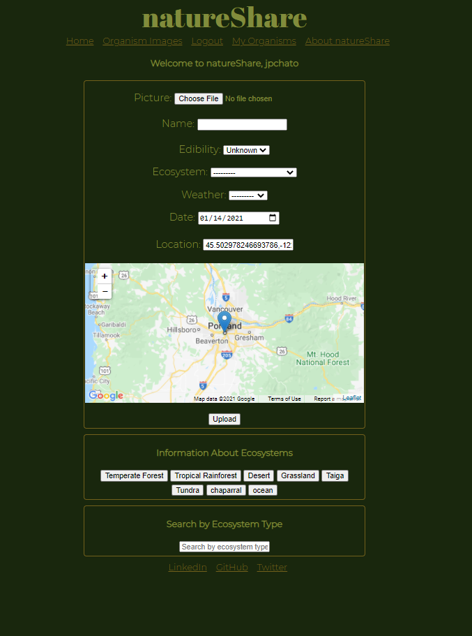
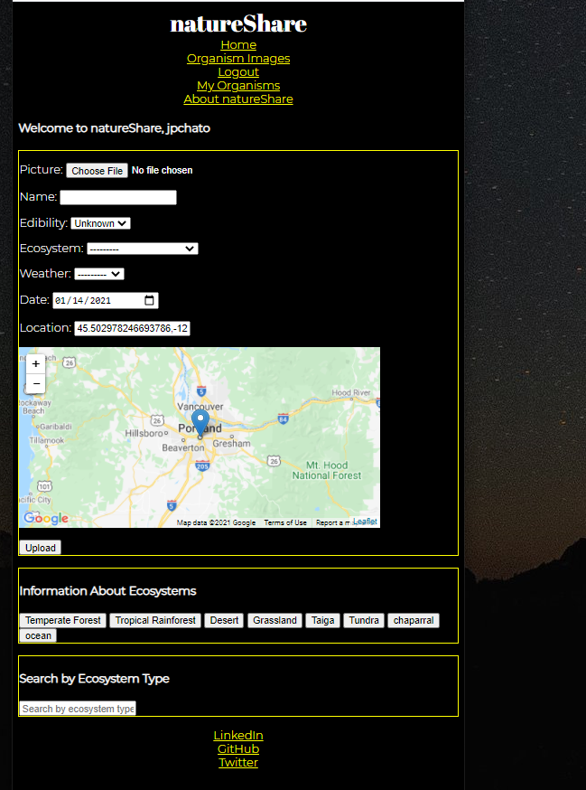

# NatureShare

A Django-based web application for sharing and tracking information about organisms found in nature. Originally designed to help with foraging activities, such as identifying edible mushrooms and other foods in the Pacific Northwest forests.

## Features

- **User Authentication**: Register, login, and logout functionality with secure account management.
- **Organism Management**: Upload images and detailed information about organisms, including location, ecosystem, weather, and edibility.
- **Search Functionality**: Search organisms by ecosystem or name. Users can view all entries but only edit/delete their own.
- **Geolocation Integration**: Use Google Maps to add latitude/longitude data for precise location tracking.
- **Social Sharing**: Share organism details to Twitter with a direct link to the detail view.
- **Responsive Design**: Optimized for both desktop and mobile views.

## Screenshots

### Desktop View


### Mobile View


## Prerequisites

- Python 3.12 or higher
- pip (Python package installer)
- Git (for cloning the repository)

## Installation

1. **Clone the repository**:
   ```bash
   git clone https://github.com/yourusername/nature-share.git
   cd nature-share
   ```

2. **Create and activate a virtual environment**:
   ```bash
   python -m venv .venv
   source .venv/bin/activate  # On Windows: .venv\Scripts\activate
   ```

3. **Install dependencies**:
   ```bash
   pip install -r natureShare/requirements.txt
   ```

4. **Set up environment variables**:
   ```bash
   cp .env.example .env
   ```
   Edit `.env` with your actual values (see Configuration section below).

5. **Run database migrations**:
   ```bash
   cd natureShare
   python manage.py migrate
   ```

## Configuration

Create a `.env` file in the root directory based on `.env.example`. Required environment variables:

- `DJANGO_SECRET_KEY`: A unique secret key for Django (generate with `python -c "from django.core.management.utils import get_random_secret_key; print(get_random_secret_key())"`).
- `DJANGO_DEBUG`: Set to `True` for development, `False` for production.
- `DJANGO_ALLOWED_HOSTS`: Comma-separated list of allowed hosts (e.g., `localhost,127.0.0.1,yourdomain.com`).
- `GOOGLE_API_KEY`: Your Google Maps API key for geolocation features.
- `DATABASE_URL`: Optional, for database configuration (defaults to SQLite).

**Note**: Never commit your `.env` file to version control. It is already included in `.gitignore`.

## Running Locally

1. **Start the development server**:
   ```bash
   python manage.py runserver
   ```

2. Open your browser and navigate to `http://127.0.0.1:8000`.

3. **Run tests**:
   ```bash
   python manage.py test
   ```

## Project Structure

- `natureShare/`: Main Django project directory.
  - `natureShareApp/`: Core app for organism CRUD operations.
  - `accounts/`: App for user authentication and management.
  - `templates/`: HTML templates.
  - `static/`: Static files (CSS, JS, images).
  - `media/`: User-uploaded media files.

## Deployment

The application is configured for deployment on platforms like Heroku or Render. Key considerations:

- Use `gunicorn` as the WSGI server (configured in `Procfile`).
- Static files are served via WhiteNoise.
- Environment variables must be set in your deployment platform's settings.

For Heroku deployment:
1. Create a Heroku app.
2. Set environment variables in Heroku dashboard.
3. Push code and run migrations.

## Contributing

1. Fork the repository.
2. Create a feature branch: `git checkout -b feature/your-feature`.
3. Commit changes: `git commit -am 'Add your feature'`.
4. Push to the branch: `git push origin feature/your-feature`.
5. Submit a pull request.

## License

This project is licensed under the MIT License. See the LICENSE file for details.

## Acknowledgments

- Built with Django and various open-source libraries.
- Inspired by foraging and nature observation communities.
- Special thanks to the contributors and the original project creators.
